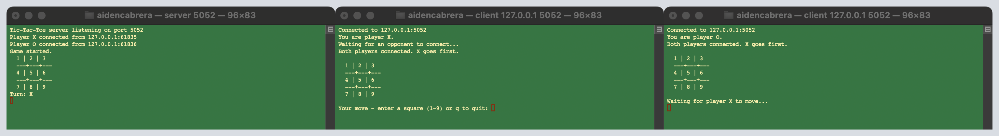
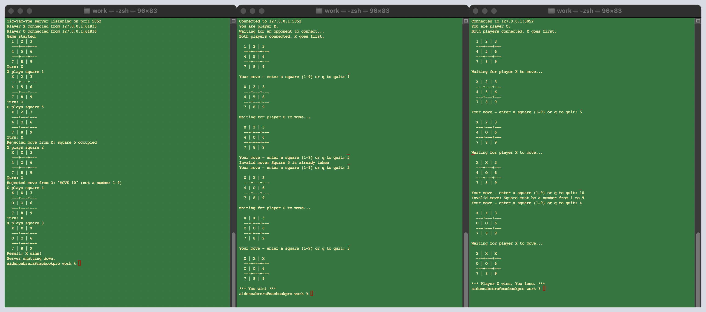

# Networked Tic-Tac-Toe (C, TCP sockets)

## Files
| File | Purpose |
|------|---------|
| `server.c` | TCP server: accepts two players, holds the authoritative board, validates moves, enforces turns, detects wins/draws, handles disconnects. |
| `client.c` | TCP client: connects to the server, displays symbol/board/turn info, reads a move only when prompted, shows results. |

## Build (Linux / WSL)
```
gcc -std=c11 -Wall -Wextra -pedantic server.c -o server
gcc -std=c11 -Wall -Wextra -pedantic client.c -o client
```
Both compile with no warnings.

## Run
Open three terminals:
```
# Terminal 1
./server 5000
# Terminal 2  (becomes X)
./client 127.0.0.1 5000
# Terminal 3  (becomes O)
./client 127.0.0.1 5000
```
For clients on other computers, use the server machine's IPv4 address instead of `127.0.0.1`.

When prompted, type a square number 1–9 (or `q` to quit):
```
  1 | 2 | 3
  ---+---+---
  4 | 5 | 6
  ---+---+---
  7 | 8 | 9
```

## Design

### Board and rules (server)
- The board is `char board[3][3]`; an empty square holds `' '`.
- Square `n` maps to `board[(n-1)/3][(n-1)%3]`.
- `parse_square()` rejects anything that is not a whole number 1–9. `is_occupied()` rejects squares that are already taken. In both cases the server sends `INVALID <reason>` and prompts the same player again, so the turn does not advance.
- After every legal move, `check_winner()` checks the 3 rows, 3 columns and 2 diagonals. If there is no winner and `board_full()` returns true, the game is a draw.

### Server structure
- `create_listener()` creates the socket, then calls `bind` and `listen` on the port from the command line.
- `wait_for_players()` accepts the first client as **X** and the second as **O**. While X waits, the server also watches X's socket. If X leaves before O arrives, the slot is freed.
- `play_game()` uses `select()` on both client sockets, so a quit or disconnect is noticed at any time, even from the player who is not moving. No threads are used.
- `handle_command()` processes one complete command. It applies a legal move, broadcasts the board, then announces the result or the next turn. A `MOVE` from the player whose turn it is not gets `INVALID It is not your turn`.
- If a client sends `QUIT` or closes its connection, the other client gets `OPPONENT_LEFT` and the server exits. One match is played per server run.

### Client structure
- `connect_to_server()` checks the IPv4 address with `inet_pton` and then connects.
- The main loop reads one message at a time and dispatches on its keyword.
- The client asks for keyboard input **only** when it receives `YOURTURN`. Anything typed out of turn is discarded with `tcflush`.
- The client never decides whether a move is legal. It sends `MOVE <whatever was typed>` and displays the server's reply.

### Protocol
Plain ASCII text. **Every message is one line ending in `\n`**; the newline is the message boundary.

Client → Server

| Message | Meaning |
|---------|---------|
| `MOVE <n>` | Place my symbol on square *n* |
| `QUIT` | Leave the game |

Server → Client

| Message | Meaning |
|---------|---------|
| `WELCOME <X\|O>` | Your assigned symbol |
| `INFO <text>` | Status text to print |
| `BOARD <9 chars>` | Board row by row; `X`, `O`, or `-` for empty (e.g. `BOARD X---O----`) |
| `TURN <X\|O>` | Whose turn it is (sent to both players) |
| `YOURTURN` | Prompt the user for a move |
| `INVALID <reason>` | Move rejected; turn does not advance |
| `WIN <X\|O>` | Game over: that player won |
| `DRAW` | Game over: board full, no winner |
| `OPPONENT_LEFT` | Game over: the other player quit or disconnected |
| `BYE` | Reply to `QUIT` |

Example exchange:
```
S→X: WELCOME X        S→O: WELCOME O
S→both: BOARD ---------
S→both: TURN X
S→X: YOURTURN
X→S: MOVE 5
S→both: BOARD ----X----
S→both: TURN O
S→O: YOURTURN
O→S: MOVE 5
S→O: INVALID Square 5 is already taken
S→O: YOURTURN
...
S→both: WIN X
```

### Handling TCP as a byte stream
A single `recv()` can return part of a message, or several messages at once. Each side therefore keeps a receive buffer:
- Incoming bytes are appended to the buffer.
- A message is processed only once a `\n` is found, and the leftover bytes stay in the buffer for the next message.
- A trailing `\r` is stripped, so `\r\n` input also works.
- `send_all()` loops until every byte has been written.

This was tested by sending `"MO"`, `"VE "`, `"5\r\n"` as three separate writes, which the server read as one move. It was also tested by sending three `MOVE` lines in a single write; the server handled each one separately.

## Testing performed
- X wins (top row), including out-of-range input (`10`), non-numeric input (`abc`) and an occupied square.
- Full-board draw.
- A player types `q` mid-game; the opponent is notified.
- A client process is killed mid-game; the opponent is notified.
- A move sent out of turn is rejected.

## Screenshots
Taken in macOS Terminal with the server on port 5052. Left: server. Middle: client X. Right: client O.

### Server and both clients connected
The server has accepted X and O. Both clients show their symbol and the empty board, and X moves first.



### Completed match
X plays 1, O plays 5, X tries 5 (rejected: already taken) and then plays 2. O tries 10 (rejected: out of range) and then plays 4. X plays 3 and wins the top row. After each rejected move, the same player is prompted again.


